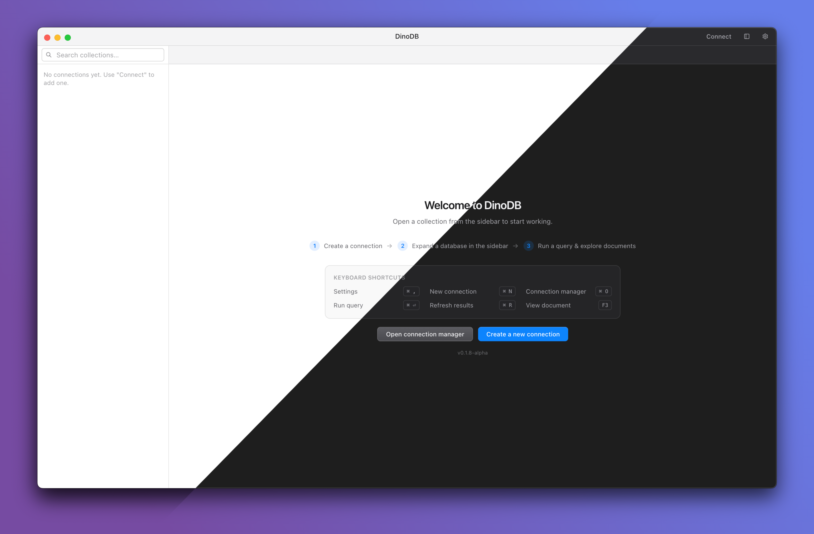

<p align="center">
  
</p>

<h1 align="center">DinoDB</h1>
<h3 align="center">A fast, native MongoDB client for the desktop.<br />Browse, query, and edit collections with ease.</h3>

<p align="center">
  
</p>

## About

DinoDB is a free, open-source MongoDB desktop client for macOS and Windows. It brings connections, queries, document editing, and database tools into a native-feeling interface built with Electron, React, and TypeScript.

Collection tabs run in separate utility processes, so a slow query does not block the rest of the app. Connection profiles and preferences are stored locally in SQLite.

## Highlights

- **Connect your way:** Save multiple MongoDB connections with SCRAM, X.509, AWS, GSSAPI, and PLAIN authentication support.
- **Query with a familiar editor:** Use a Monaco-powered shell-style editor for reads, writes, aggregation, and explain plans.
- **Explore and edit data:** Browse databases and collections, inspect schema-aware results, and create, update, or delete documents.
- **Move data between systems:** Import and export BSON, Extended JSON, Simple JSON, and CSV, with progress and cancellation controls.
- **Back up and restore databases:** Run `mongodump` and `mongorestore` through the app using separately installed [MongoDB Database Tools](https://www.mongodb.com/try/download/database-tools) 100.3.0 or later.
- **Work your way:** Organize tabs and choose light, dark, or system appearance.

## Supported platforms

| Platform                            | Release format   |
| ----------------------------------- | ---------------- |
| macOS 12+ (Intel and Apple silicon) | `.dmg`, `.zip`   |
| Windows 10/11 (x64)                 | `.exe` installer |
| Linux                               | Planned          |

## Download

Get DinoDB from [GitHub Releases](https://github.com/imraheel/DinoDB/releases). Choose the macOS `.dmg` or `.zip`, or the Windows `.exe` installer for your system.

## Build from source

You need Node.js 22 and pnpm 10. From a terminal:

```sh
git clone https://github.com/imraheel/DinoDB.git
cd DinoDB
pnpm install --frozen-lockfile
pnpm dev
```

To create a production build, run `pnpm build`. To package the app, run `pnpm package:mac` on macOS or `pnpm package:win` on Windows. Packages are written to `dist/`.

## How to contribute

Bug reports, ideas, documentation, and code contributions are welcome. Search [existing issues](https://github.com/imraheel/DinoDB/issues) before opening a new one, and see [CONTRIBUTING.md](./CONTRIBUTING.md) for setup, project layout, checks, and pull request guidance.

## License

DinoDB is licensed under the [GNU General Public License v3.0](./LICENSE) (`GPL-3.0-only`).

## DMCA notice

If you believe material in this repository or its GitHub Releases infringes your copyright, follow [GitHub's guide to submitting a DMCA takedown notice](https://docs.github.com/en/site-policy/content-removal-policies/guide-to-submitting-a-dmca-takedown-notice). Identify the copyrighted work and the specific repository or release URLs in your notice. GitHub's guide explains the remaining information required and the counter-notice process.
